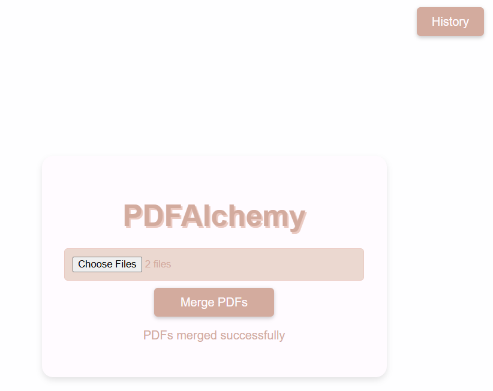

# PDFAlchemy — Original PDF Merger (Restored)

This repository restores the **original PDFAlchemy student web application** and its visual design. It uses the original HTML and CSS for the PDF upload page and merge-history page—not a replacement interface. The backend has focused fixes so files can be merged, downloaded, recorded in history, and downloaded again later.


### Original PDFAlchemy interface



The screenshot above shows the original PDFAlchemy upload screen running locally.

## Original features

- Select **2–5 PDF documents** and merge them in upload order
- Download the merged result automatically
- Visit the **History** page to see previous merges, source filenames, and dates
- Download previously merged documents again from the History page
- Save files and history between runs, using local storage by default or **optional MongoDB**

## Run locally

Install Node.js **20 or newer**. In this directory, run:

```bash
npm install
npm start
```

Open **http://127.0.0.1:3000** and choose 2–5 PDFs. Click **History** to find earlier merges.

**No MongoDB setup is required** for normal local use: PDFAlchemy writes merge history to `data/history.json` and finished PDFs to `data/merged/`. Both are kept between runs and ignored by Git. If you want the original MongoDB-backed history, create a `.env` file based on `.env.example` with `MONGODB_URI=mongodb://127.0.0.1:27017/pdfalchemy` and start your MongoDB service first.

## Tests

Run `npm test`. See `VERIFICATION.md` for what has actually been tested. Integration tests use the local-storage mode and do not require MongoDB.

## File structure

```text
PDFAlchemy-PDF-Merger/
├── index.js                  # Original server behavior, with necessary bug fixes
├── historyStore.js           # Persistent JSON history + optional MongoDB history
├── public/
│   ├── index.html            # ORIGINAL PDFAlchemy interface
│   ├── styles.css            # ORIGINAL styles
│   ├── script.js             # ORIGINAL upload UI logic
│   ├── history.html          # ORIGINAL history-page interface
│   ├── history.css           # ORIGINAL history styling
│   ├── history.js            # Displays safe filenames and working download links
│   └── merged-pdfs.html      # Original unused placeholder file (preserved)
├── controllers/              # Original coursework modules (preserved)
├── models/                   # Original coursework module (preserved)
├── routes/                   # Original coursework module (preserved)
├── database.js               # Original MongoDB connection module (preserved)
├── data/                     # PRIVATE uploads, history and merged PDFs; gitignored
├── tests/                    # Integration tests
├── .env.example
└── README.md
```
